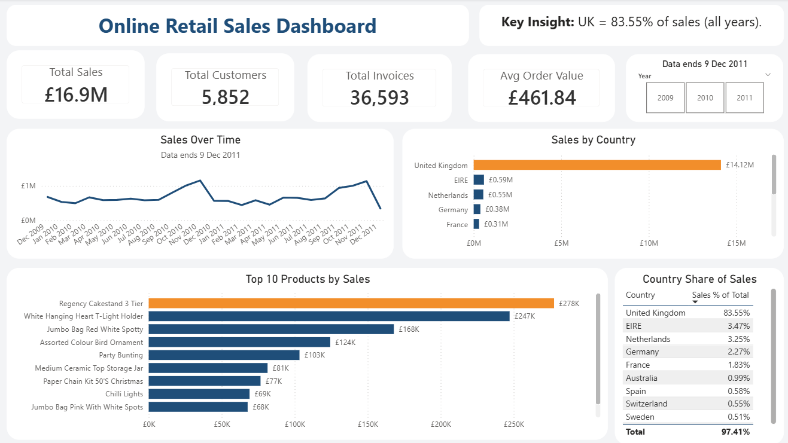
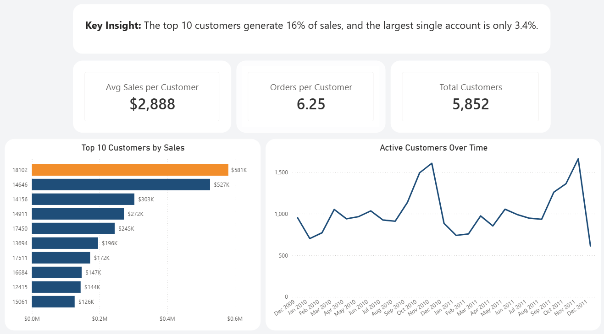
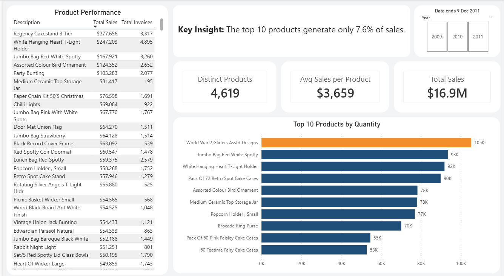
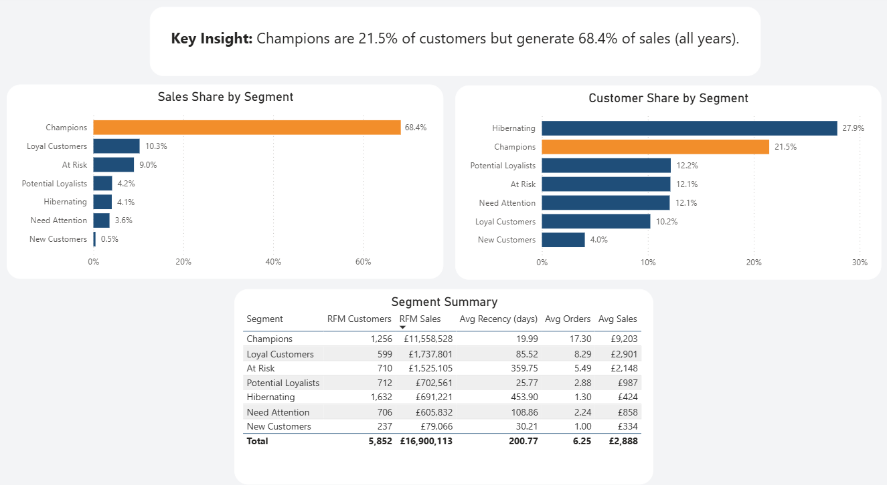
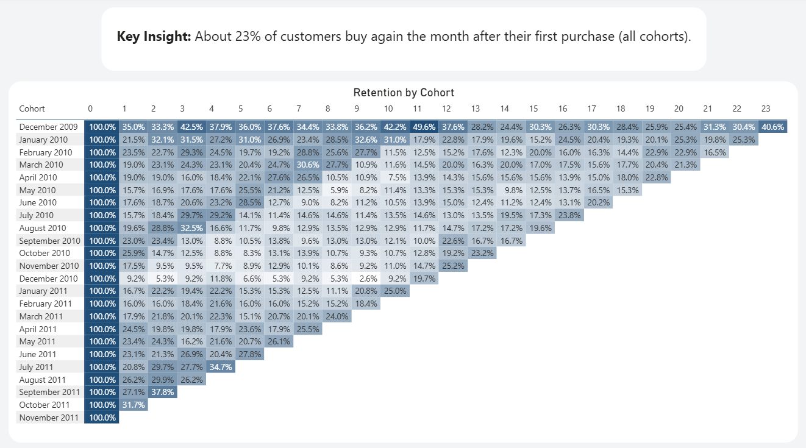

# Online Retail II: Sales, RFM and Cohort Analysis

End-to-end analysis of 2 years of UK online retail transactions (Dec 2009 – 9 Dec 2011): data cleaning in PostgreSQL, customer segmentation with RFM, cohort retention, and a 7-page Power BI dashboard.

## Key Results

- Champions are 21.5% of customers (1,256) but generate 68.4% of sales.
- Hibernating customers are 27.9% of customers but only 4.1% of sales.
- At Risk customers (710) account for 9.0% of sales (about $1.5M) and last bought about 360 days ago on average.
- About 23% of new customers buy again the month after their first purchase.
- The UK generates 83.55% of sales ($16.9M total, 36,593 invoices, 5,852 customers).

## Dashboard

The Notes and Insights & Recommendations pages are in the `screenshots` folder.

## Data and Cleaning

**Source:** Online Retail II (UK online retailer), Dec 2009 – 9 Dec 2011. December 2011 is a partial month.

| Step | Rule | Note |
|---|---|---|
| Raw data | 1,067,371 rows | `raw_retail` table |
| Cancelled invoices | Removed invoices with prefix "C" | |
| Invalid values | Removed rows with Quantity ≤ 0 or Price ≤ 0 | |
| Duplicates | Removed exact duplicate rows | |
| Missing Customer ID | Removed (about 22% of rows) | Customer analysis needs an ID, so Total Sales is lower than the raw total |
| Non-product codes | Removed non-product StockCodes | SP1002 was kept (real product) |
| Outlier | Excluded invoice 581483 | 80,995 units, $168K, cancelled minutes later |
| Clean data | 776,578 rows | `retail_clean` table |

The `price` column is `NUMERIC` without scale. `NUMERIC(12,2)` rounded very small prices to 0.00 and silently dropped 18 rows.

## Methodology Notes

- **RFM:** reference date 10 Dec 2011. R and M use `NTILE(5)`; F uses fixed bands (1, 2, 3–4, 5–8, 9+) so equal invoice counts get equal scores. Segment thresholds are my own design choice, not a standard.
- **Cohorts:** a cohort is the month of a customer's first purchase. Dec 2011 cells are removed (incomplete month), and the Dec 2009 cohort includes returning customers.

- ## Power BI Model

 - **Power Query:** loads `online_retail_II.xlsx` through the `p_FilePath` parameter and applies the same cleaning steps as the SQL script. The row counts match at every step.
- **Data sources:** `rfm_segments.csv` (5,852 rows) and `cohort_retention_final.csv` (300 rows), exported from PostgreSQL.
- **DAX measures:** Total Sales, Total Customers, Total Invoices, Avg Order Value, RFM Customers, RFM Sales, RFM Customers %, RFM Sales %, Cohort Active, Cohort Size, Retention %, Avg Retention %.
- **Dashboard:** 7 pages: Overview, Customers, Products, RFM, Cohort, Notes, Insights & Recommendations.

## How to Run

1. Download the Online Retail II dataset and save it as `raw/online_retail_II.xlsx`. Export the two sheets as `raw_2009_2010.csv` and `raw_2010_2011.csv` in the same folder.
2. In PostgreSQL 16 (database: `online_retail`), run section 0 of `online_retail_ii_sql.sql` to create `raw_retail`. Import both CSV files into it with pgAdmin (header on, delimiter ","), then run the rest of the script.
3. Open `online_retail_ii_dashboard.pbix` in Power BI Desktop.
4. In Power Query, set the `p_FilePath` parameter to the full path of `online_retail_II.xlsx`, then refresh.

## Tools

PostgreSQL 16, pgAdmin, Power BI (Power Query, DAX), Excel
